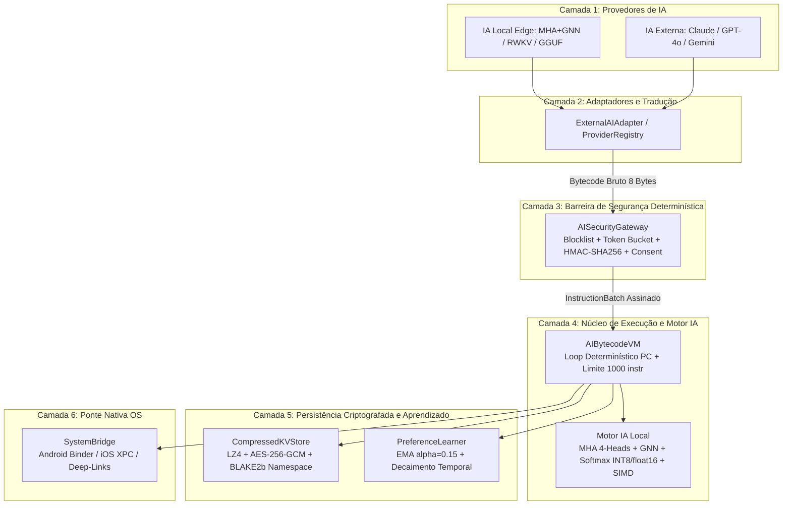
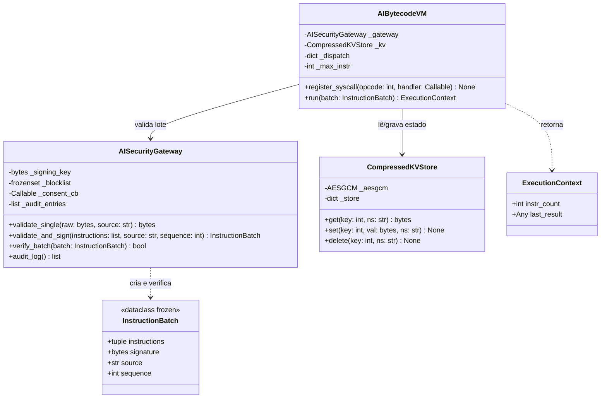

# 🛡️ AIOS-BC — AI Operating System Bytecode Protocol (v1.0)

## 1. O que é o Projeto, Objetivo e Para que Serve
O **AIOS-BC** é uma camada de infraestrutura *Edge AI* 100% *on-device* baseada em um protocolo binário de instrução fixa de **8 bytes (64 bits, big-endian)**.

* **Qual problema ele resolve:** Agentes de IA atuais trocam comandos em texto livre (JSON/linguagem natural), o que consome muita memória, drena bateria em dispositivos móveis e abre brechas graves para *Prompt Injection* (quando uma IA externa enganada tenta executar comandos destrutivos no aparelho do usuário).
* **Para que serve:** Funciona como um **Firewall Determinístico e Máquina Virtual entre qualquer LLM (Claude, GPT-4o, Gemini ou modelos locais RWKV/GGUF) e o Sistema Operacional (Android/iOS/Desktop)**. A IA nunca toca no sistema operacional diretamente: ela emite bytecode de 8 bytes, o `AISecurityGateway` valida e assina o lote com `HMAC-SHA256`, e a `AIBytecodeVM` executa de forma isolada em menos de 100ms e ocupando menos de 8 MB de RAM.

---

## 2. Modelo Conceitual (Arquitetura em 6 Camadas)
O sistema é dividido em 6 camadas isoladas com fluxo estrito de validação Zero-Trust:



---

## 3. Modelo Lógico de Dados (Instrução Binária de 64 Bits)
Toda instrução no AIOS-BC possui comprimento fixo de **8 bytes (`>BBIH` — Big-Endian)**, eliminando vulnerabilidades de *parser* e garantindo decodificação em tempo constante $O(1)$:

| Campo | Tamanho | Tipo Struct | Descrição Lógica |
| :--- | :---: | :---: | :--- |
| **`OPCODE`** | 1 Byte (8 bits) | `B` (`uint8`) | Identificador da operação (`0x00` a `0xFF`). Faixas `0x60-0x7F` e `0xF0+` bloqueadas para IA externa. |
| **`FLAGS`** | 1 Byte (8 bits) | `B` (`uint8`) | Bits de controle: `PRIVILEGED (0x01)`, `ENCRYPTED (0x02)`, `AUDITED (0x04)`, `NO_CACHE (0x08)`, `ASYNC (0x10)`. |
| **`KEY`** | 4 Bytes (32 bits) | `I` (`uint32`) | Endereço de chave no KV Store ou identificador de contexto/aplicativo. |
| **`VALUE`** | 2 Bytes (16 bits) | `H` (`uint16`) | Parâmetro imediato da operação ou ponteiro de registrador. |

---

## 4. Diagrama de Classes (UML Oficial da Arquitetura)



---

## 5. Estrutura Oficial de Diretórios
```text
aios-bc/
├── core/                  # Núcleo da VM, Opcodes, KV Store e Motor MHA/GNN/Softmax
├── security/              # AISecurityGateway, HMAC, Token Bucket e Auditoria
├── adapters/              # Adaptadores para IAs Externas e Provedores Locais (RWKV/GGUF)
├── learning/              # Aprendizado Contínuo On-Device (EMA)
├── bridge/                # Ponte de integração com Sistema Operacional (Android/iOS)
├── sdk/python/            # SDK Público para integração
├── tests/                 # Suíte de Testes Unitários, Segurança e Integração (Pytest)
├── .github/workflows/     # Pipeline CI/CD Automatizado (GitHub Actions)
├── requirements.txt       # Dependências enxutas homologadas
└── README.md              # Documentação Arquitetural e Diário de Sprints
```

---

## 📅 Diário de Sprint — Sprint 0 (Day 1): Passo 1 (Fundação e CI/CD)

### O que foi feito hoje
- **Reset e Padronização Estrutural**: Criação limpa da árvore de diretórios modular conforme a Seção 13.1 da especificação técnica.
- **Documentação Arquitetural Unificada (`README.md`)**: Consolidação do modelo conceitual de 6 camadas, modelo lógico binário de 64 bits (`>BBIH`) e diagrama de classes UML.
- **Pipeline de CI/CD (`.github/workflows/ci_cd.yml`)**: Configuração de Integração Contínua executando `pytest` com verificação de cobertura a cada *Push/Pull Request* e Entrega Contínua gerando artefatos `.tar.gz` em *GitHub Releases* a cada tag de versão.

### Como isso contribui para a Sprint atual e próximas entregas
Estabelece o contrato arquitetural único e a esteira automatizada de qualidade antes da escrita da primeira linha de código de produção. Isso permite que a equipe trabalhe em paralelo sem conflitos de merge: a Frente 1 foca em `core/opcodes.py` e `security/gateway.py`, enquanto a Frente 2 desenvolve `core/kv_store.py` e `core/interpreter.py`, ambos validados automaticamente pelo GitHub Actions.